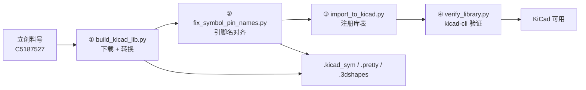

<div align="center">

# LCSC2KiCad

把**立创商城 / 嘉立创EDA（LCSC / EasyEDA）**的元件，变成能直接用的 **KiCad** 符号 + 封装 + 3D 模型。

[快速开始](#快速开始) · [工作原理](#工作原理) · [已内置的坑](#已内置的坑) · [作为 Agent Skill](#作为-agent-skill-使用) · [English](#english)


</div>

---

给一个立创料号（`C` 开头，例如 `C5187527`），得到：

```
myproj.kicad_sym       符号库（引脚名已按嘉立创真值对齐）
myproj.pretty/         封装库（*.kicad_mod）
myproj.3dshapes/       3D 模型（*.step + *.wrl）
```

然后自动注册进 KiCad 库表，并用 KiCad 自己的解析器（`kicad-cli`）验证能读。

## 快速开始

```bash
# 1. 依赖
pip install easyeda2kicad

# 2. 下载本仓库
git clone https://github.com/<你的账号>/lcsc2kicad.git
cd lcsc2kicad

# 3. 转换（限流自动退避；--output 是库基名）
python scripts/build_kicad_lib.py --lcsc-id C5187527 --output ./myproj

# 4. 引脚名按嘉立创原始数据（name.is_displayed）对齐
python scripts/fix_symbol_pin_names.py ./myproj.kicad_sym --fetch C5187527

# 5. 注册进项目（只改项目自己的库表，不动全局配置）
python scripts/import_to_kicad.py --lib-basename ./myproj --project-local .

# 6. 验证：用 KiCad 自己的解析器
python scripts/verify_library.py --lib-basename ./myproj
```

打开 KiCad → 原理图按 `A` → 搜库昵称 → 元件就在那里。

## 工作原理



四件事，四个脚本，互不强耦合：

| 脚本 | 做什么 |
|---|---|
| `build_kicad_lib.py` | 批量下载并转成 KiCad 库；自带 403 限流退避、GBK 控制台保护、同名封装覆盖 |
| `fix_symbol_pin_names.py` | 用 EasyEDA 逐引脚 `name.is_displayed` 真值修"引脚名压编号"；顺手去 UTF-8 BOM |
| `import_to_kicad.py` | 项目本地（`${KIPRJMOD}`）或全局注册，自动备份 + 读回校验 + 幂等 + 可卸载 |
| `verify_library.py` | 计数 / 括号平衡 / `sym upgrade` / `fp upgrade`，exit code 说真话 |

## 已内置的坑

这些不是"注意事项"，是已经踩过并写进代码的（细节见 [references/pitfalls.md](references/pitfalls.md)）：

| 坑 | 处理 |
|---|---|
| 连续转换约 13 个后全部 `HTTP 403`（IP 级限流） | 每件间隔 5~10 s、失败退避 30~60 s；仍失败等 10~30 分钟或换网络 |
| 中文 Windows 控制台 `UnicodeEncodeError: 'gbk'` | 脚本强制 UTF-8 stdout，日志用 ASCII 标记 |
| 引脚名和引脚编号重叠成一团 | 读嘉立创逐引脚开关，按真值决定隐藏/显示；KiCad 只支持整符号开关，逐引脚则清空文本 |
| 符号库带 UTF-8 BOM，KiCad 直接"无法加载库" | 读入 `utf-8-sig`、写回无 BOM |
| 全局库表写入后"看起来成功"其实没写 | 每处写入都读回校验 |
| 重装 KiCad / 迁移项目后库全丢 | 推荐项目本地注册，`${KIPRJMOD}` 相对路径，项目可搬走 |
| `kicad-cli fp upgrade` 对当前格式库"无输出"被误判失败 | 用 `--force` 重写，或识别"已是当前格式" |

## 作为 Agent Skill 使用

仓库根部的 `SKILL.md` 就是给 AI Agent 的入口（Claude Code、DSH、Codex 等通用）：

```bash
# 通用 agent skills 目录（按你的工具约定调整）
git clone https://github.com/<你的账号>/lcsc2kicad.git ~/.agents/skills/lcsc2kicad
# Claude Code:  ~/.claude/skills/lcsc2kicad
```

之后直接说"把 C5187527 转成 KiCad 库"，Agent 会按 `SKILL.md` 的流水线执行。
脚本也可以脱离 Agent 单独用，就是上面的快速开始。

## 仓库结构

```
lcsc2kicad/
├── SKILL.md                     # Agent 入口：流水线、命令、检查清单
├── scripts/                     # 四个可独立运行的脚本
│   ├── build_kicad_lib.py
│   ├── fix_symbol_pin_names.py
│   ├── import_to_kicad.py
│   └── verify_library.py
├── references/
│   ├── pitfalls.md              # 17 条实测坑 + 附录 A（17 个料号）
│   ├── easyeda-kicad-mapping.md # 单位/图层/焊盘/3D 映射 + KiCad 格式实测事实
│   └── sample-lcsc-ids.md       # 示例料号表（可直接当 --ids-file）
├── README.md
├── NOTICE.md                    # 第三方归属
└── LICENSE                      # MIT
```

## 适用边界

- 转换数据来自社区抓取的 EasyEDA 库，**不是立创官方 KiCad 库**；
- **上板前必须对照数据手册核对封装尺寸、引脚间距、引脚编号顺序**（镜像/反向是高频错误）；
- 模块类元件（排针、RJ11、变压器、隔离电源）建议优先用 KiCad 自带通用符号；
- 3D 模型缺失约 10~20%，不影响出板。

## License 与致谢

本仓库代码与文档以 **MIT** 发布，见 [LICENSE](LICENSE)；第三方归属见 [NOTICE.md](NOTICE.md)。

- 转换依赖 [easyeda2kicad.py](https://github.com/uPesy/easyeda2kicad.py)（AGPL-3.0，作为外部依赖安装，不随本仓库分发）；
- 格式映射的部分结论参考了 [LCKiConverter](https://github.com/xtoolbox/lckiconverter)（MIT）；
- EasyEDA / 立创商城 / KiCad 的商标归各自所有者。

---

## English

**LCSC2KiCad** turns LCSC / EasyEDA parts (IDs like `C5187527`) into ready-to-use KiCad symbol,
footprint and 3D libraries, registers them into project or global library tables, and verifies
the result with KiCad's own `kicad-cli` parser.

It exists because the naive `easyeda2kicad` flow breaks on real projects: API rate limiting,
GBK console crashes, lost per-pin `name.is_displayed` flags, UTF-8 BOMs that KiCad refuses to load,
and library tables that get silently overwritten.

Four standalone scripts + a `SKILL.md` for AI agents (Claude Code / DSH / Codex compatible).
MIT licensed. Tested with easyeda2kicad 1.0.1, KiCad 10.0.6, Python 3.13 on Windows.

```bash
pip install easyeda2kicad
python scripts/build_kicad_lib.py --lcsc-id C5187527 --output ./myproj
python scripts/fix_symbol_pin_names.py ./myproj.kicad_sym --fetch C5187527
python scripts/import_to_kicad.py --lib-basename ./myproj --project-local .
python scripts/verify_library.py --lib-basename ./myproj
```
